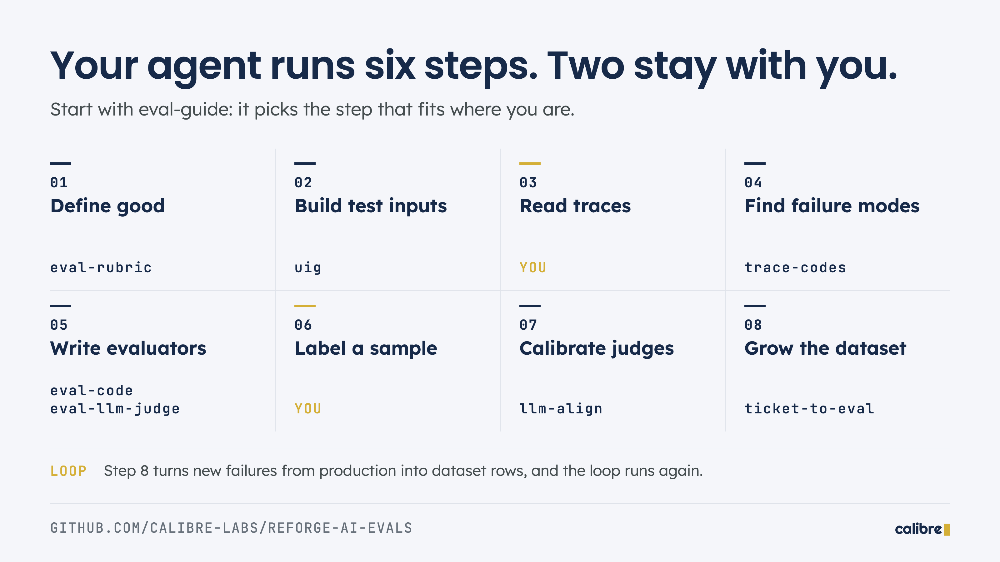

# AI Evals Toolkit

Skills that guide AI coding agents (Claude Code, Codex, Cursor and others) to build evals for your AI product: eval rubrics, eval datasets, trace analysis, code-based evaluators, LLM-as-a-judge prompts and judge alignment.

From the [Reforge AI Evals course](https://www.reforge.com/courses/ai-evals) by Sandhya Hegde and Justin Bauer of [Calibre](https://calibrelabs.ai).

## How it works

Your coding agent can do most of the eval work if it has the right instructions. Two steps stay with you: **reading traces** and **labeling outputs** to calibrate judges. The skills cover the rest.

Start with **[eval-guide](skills/eval-guide/SKILL.md)**. It looks at where you are and loads the right skill.



| Step | Skill | What it does |
|------|-------|--------------|
| 1. Define good | [eval-rubric](skills/eval-rubric/SKILL.md) | Writes the eval rubric into your PRD: v1 before traces, v2 after |
| 2. Build test inputs | [uig](skills/uig/SKILL.md) | Designs a diverse eval dataset with a User Input Grid and finds coverage gaps |
| 3. Read traces | **You** | Annotate what went wrong, in your own words |
| Optional, for step 3 | [trace-review-app](skills/trace-review-app/SKILL.md) | Designs and builds a one-file review app for your product's traces, with notes, labels, trace codes and exports (draft) |
| 4. Find failure modes | [trace-codes](skills/trace-codes/SKILL.md) | Clusters your notes into named yes/no failure codes |
| 5. Write evaluators | [eval-code](skills/eval-code/SKILL.md), [eval-llm-judge](skills/eval-llm-judge/SKILL.md) | Code checks for objective failures, LLM judges for subjective ones |
| 6. Label a sample | **You** | Mark outputs pass or fail |
| 7. Calibrate judges | [llm-align](skills/llm-align/SKILL.md) | Measures each judge against your labels (TPR/TNR) and fixes its prompt |
| 8. Grow the dataset | [ticket-to-eval](skills/ticket-to-eval/SKILL.md) | Turns support tickets and bad traces into regression eval rows |

Coming next: `eval-run` (run the agent and scorers over a dataset), `eval-trace` (tool calls and multi-step traces) and `eval-monitor` (score production and report drift).

## Install

**Any coding agent**, with [npx skills](https://github.com/vercel-labs/skills):

```bash
npx skills add https://github.com/Calibre-Labs/reforge-ai-evals
```

Add `--skill trace-codes` to install one skill, and run `npx skills update` to get new versions.

**Claude Code plugin:**

```bash
claude plugin marketplace add Calibre-Labs/reforge-ai-evals
claude plugin install ai-evals@calibre-labs
```

**Manual:** copy any folder in [`skills/`](skills/) into your agent's skills directory. The skills read and write plain files (markdown, CSV, JSON, HTML), so you don't need an eval platform account.

Then ask your agent something like:

```
Write a v1 eval rubric from my PRD.
```

## Worked examples

- **[Templates](templates/):** an AI PRD template, plus PRDs, v1 and v2 eval rubrics, simulated sessions and annotated traces for three agents: Corner (consumer shopping), Ledger (enterprise finance) and Mapper (market research, with 10 traces to annotate).
- **[Market Map User Input Grid](docs/uig-market-map.md):** a complete worked UIG for the single-prompt market research agent from the spring 2026 cohort.

## FAQ

<details>
<summary><b>What is an AI eval?</b></summary>

An AI eval is a repeatable test that scores an AI feature's outputs against defined criteria, so you can tell whether a prompt, model or agent change made the product better or worse. A useful setup has three parts: a dataset of realistic inputs, evaluators that score each output, and a loop that reruns them on every change.
</details>

<details>
<summary><b>What is LLM-as-a-judge?</b></summary>

Using a language model to grade another model's output against a written criterion. It's for semantic qualities code can't check, such as whether an answer is correct or an ambiguous request was handled well. A good judge tests one criterion, has binary PASS/FAIL definitions and few-shot examples (including a borderline case), and writes its critique before its score.
</details>

<details>
<summary><b>When should I use a code-based evaluator instead of an LLM judge?</b></summary>

Use code for anything structural and deterministic: counts, required sections, citations, formats. It's fast, free and never drifts. Use an LLM judge for meaning: correctness, relevance, tone, edge-case handling. Most products need both.
</details>

<details>
<summary><b>How do I know whether my LLM judge is trustworthy?</b></summary>

Label 20–40 outputs by hand (roughly half PASS, half FAIL), run the judge on the same outputs, and compute TPR (how often it agrees when a human said PASS) and TNR (how often it agrees when a human said FAIL). Aim for both above 90%, with 80% as the minimum. Track them separately: a judge with high overall accuracy can still be too lenient.
</details>

<details>
<summary><b>What is a User Input Grid?</b></summary>

A method for designing eval datasets that cover the real diversity of inputs an agent will face. List the dimensions along which user inputs vary (such as query type, domain, phrasing style and time frame) and the values each can take, then check that your dataset hits every value several times. It replaces datasets built from engineer intuition, which overfit to what engineers know, or from raw logs, which overfit to easy, common cases. See the [Market Map example](docs/uig-market-map.md).
</details>

<details>
<summary><b>How big should an eval dataset be?</b></summary>

Coverage matters more than size. 30–80 inputs that hit every value of every dimension at least 3 times usually beat 500 random ones. Tag every row with its dimension values so you can slice results and see where the agent fails.
</details>

<details>
<summary><b>What goes in an AI PRD and an eval rubric?</b></summary>

An AI PRD specifies the agent's behavior, not screens, including how much autonomy it has and the release thresholds that gate a launch. The eval rubric lists the criteria the agent is judged on, with the definition of success and known risks next to the criteria they justify. Write v1 from the PRD before reading any traces, then sharpen it into v2 after trace analysis.
</details>

<details>
<summary><b>What are the most common eval mistakes?</b></summary>

- Writing evaluators before reading traces, so they test what you imagined instead of how the agent actually fails.
- Compound judges that check several things at once, which are uninterpretable when they fail.
- Trusting a judge without checking it against human labels.
- Datasets built from intuition or raw logs instead of deliberate coverage.
- Running evals ad hoc instead of on every prompt or model change.
</details>

<details>
<summary><b>Do I need a particular eval platform or model?</b></summary>

No. The skills work in any coding agent that supports skills, and they read and write plain files. `llm-align` and `ticket-to-eval` can also read from platforms such as Braintrust or LangSmith if your data lives there.
</details>

## About

Built by Sandhya Hegde and Justin Bauer, co-founders of [Calibre](https://calibrelabs.ai), an applied AI research and consulting firm. Calibre writes about AI product quality at [blog.calibrelabs.ai](https://blog.calibrelabs.ai). The [Reforge AI Evals course](https://www.reforge.com/courses/ai-evals) also covers production monitoring, agent success metrics and the eval-driven roadmap.

Code is [MIT](LICENSE). Skills, templates, datasets and docs are [CC BY 4.0](LICENSE-CONTENT). To cite this repo, use GitHub's "Cite this repository" button.
